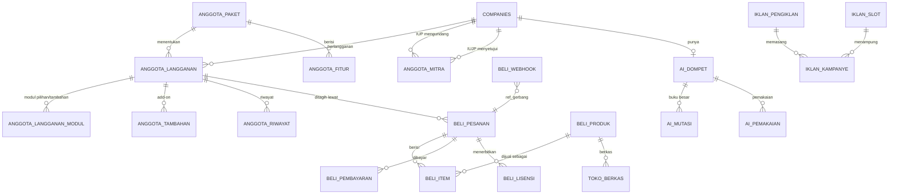
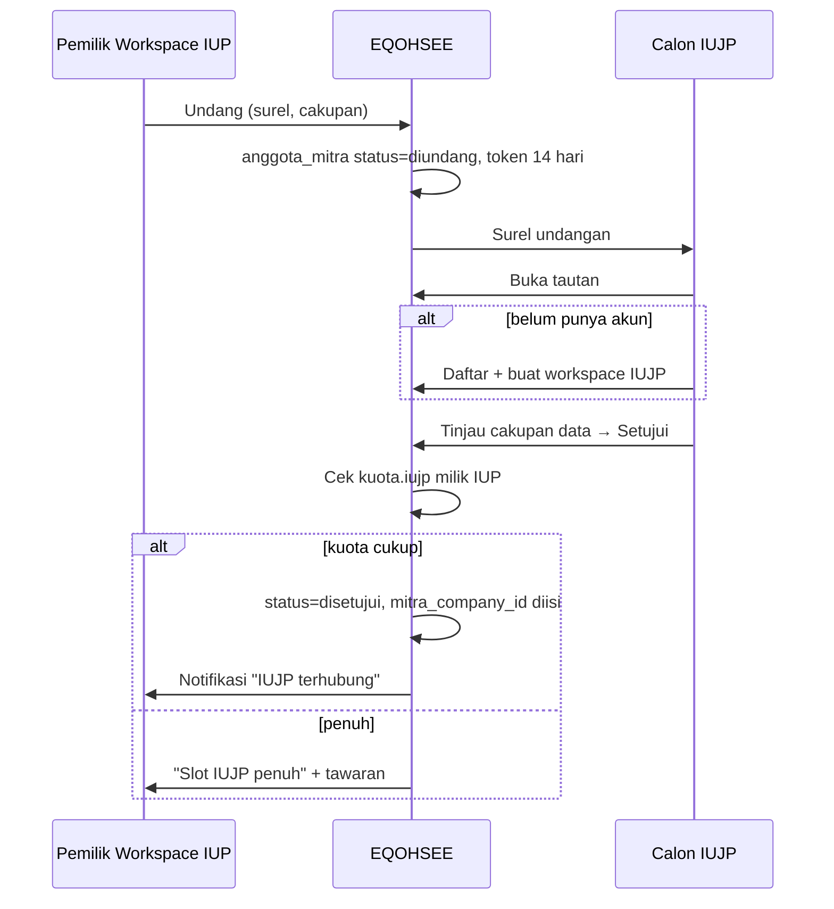
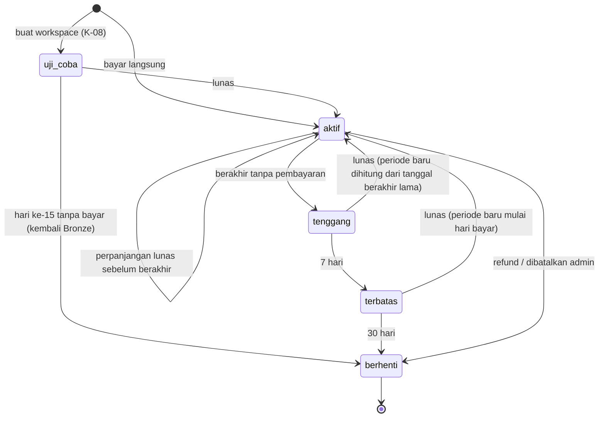
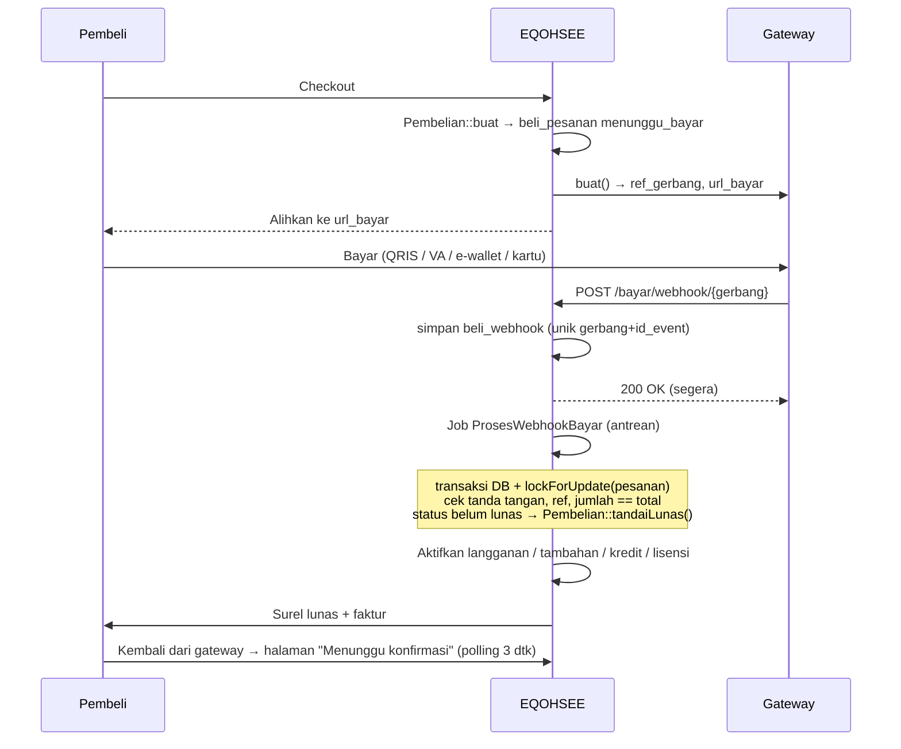

# FSD — Monetisasi & Membership EQOHSEE

**Jenis dokumen:** Functional Specification Document (FSD)
**Versi:** 1.0 (draf untuk ditinjau — belum ada kode yang diubah)
**Tanggal:** 28 November 2026
**Dokumen pasangan:** [PRD-Monetisasi-Membership.md](PRD-Monetisasi-Membership.md) · [Model-Pendapatan-dan-Proyeksi.md](Model-Pendapatan-dan-Proyeksi.md)
**Tumpukan:** Laravel 13 (PHP 8.4) + Inertia 3/Vue 3 + MySQL (PostgreSQL didukung lewat `PindahKePgsql`), antrean Laravel, penjadwal `routes/console.php`

Kode **FR-xxx** merujuk kebutuhan fungsional di PRD §9. Kode **K-xx** merujuk keputusan terbuka di PRD §13.3 — nilai yang ditulis di sini adalah rekomendasinya dan harus disesuaikan bila keputusannya berbeda.

---

## Daftar isi

1. Arsitektur & prinsip
2. Glosarium
3. Model data
4. Mesin Hak Akses
5. Workspace & relasi IUP–IUJP
6. Siklus hidup langganan
7. Tagihan, prorata & pajak
8. Pembayaran & webhook
9. Kredit AI
10. Produk digital & kursus
11. Iklan, sponsor & rewarded
12. Lencana
13. Rute & layar
14. Monetization Center & definisi metrik
15. Notifikasi & penjadwal
16. Keamanan, privasi & jejak audit
17. Migrasi & kompatibilitas
18. Konfigurasi
19. Pengujian & kriteria penerimaan
20. Estimasi pekerjaan

---

## 1. Arsitektur & prinsip

### 1.1 Memperluas, bukan mengganti

Modul Pembelian (`beli_*`, `App\Support\Pembelian`) tetap menjadi **satu-satunya jalur uang**: setiap pembelian — paket membership, add-on, kredit AI, produk digital, kursus, sponsor — adalah `beli_pesanan` dengan `beli_item`. Aturan yang sudah ada tetap berlaku: rupiah `bigInteger`, harga disalin ke baris tagihan, harga tidak pernah diterima dari klien, lisensi terbit sekali.

Yang ditambahkan adalah lapisan **hak** (siapa boleh apa) dan **langganan** (hak yang punya periode dan diperpanjang).

### 1.2 Struktur kode

```text
app/
├── Models/
│   ├── Pembelian/          (ada) Produk, Pesanan, Item, Pembayaran, Lisensi
│   │   ├── Webhook.php     baru — beli_webhook
│   │   └── Kupon.php       baru — beli_kupon, beli_kupon_pakai
│   ├── Anggota/            baru
│   │   ├── Paket.php            anggota_paket
│   │   ├── Fitur.php            anggota_fitur
│   │   ├── Langganan.php        anggota_langganan
│   │   ├── LanggananModul.php   anggota_langganan_modul
│   │   ├── Tambahan.php         anggota_tambahan
│   │   ├── Riwayat.php          anggota_riwayat
│   │   └── Mitra.php            anggota_mitra (IUP ↔ IUJP)
│   ├── Ai/                 baru — Dompet, Mutasi, Pemakaian
│   ├── Toko/               baru — Berkas, Unduhan
│   └── Iklan/              baru — Pengiklan, Kampanye, Slot, StatistikHarian, Hadiah
├── Support/
│   ├── Pembelian.php       (ada) diperluas: jenis tagihan, kupon, PPN
│   ├── Anggota/
│   │   ├── Hak.php              satu-satunya sumber keputusan akses
│   │   ├── PetaHak.php          alamat → kunci hak (pola Menu::PETA_ALAMAT)
│   │   ├── Siklus.php           perpanjangan, tenggang, terbatas, downgrade
│   │   ├── Prorata.php          hitung upgrade
│   │   └── Undangan.php         undangan & persetujuan IUJP
│   ├── Gerbang/
│   │   ├── GerbangBayar.php     antarmuka
│   │   ├── Midtrans.php
│   │   ├── Xendit.php
│   │   └── Manual.php           QRIS statis/dinamis + transfer (perilaku hari ini)
│   ├── Ai/Kredit.php            tahan, selesaikan, kembalikan
│   └── Metrik.php               MRR, churn, ARPU, NRR, LTV
├── Http/
│   ├── Middleware/PastikanHak.php
│   └── Controllers/
│       ├── HargaController.php        /harga, checkout
│       ├── LanggananController.php    /langganan (pemilik workspace)
│       ├── WorkspaceController.php    buat workspace, undang IUJP
│       ├── WebhookBayarController.php /bayar/webhook/{gerbang}
│       ├── TokoController.php         /toko
│       ├── IklanController.php        tayang, klik, rewarded
│       └── Admin/MonetisasiController.php
└── Console/Commands/
    ├── AnggotaPasangPaket.php   anggota:paket — terbitkan paket & fitur awal
    ├── AnggotaSiklus.php        anggota:siklus — harian
    ├── BayarRekonsiliasi.php    bayar:rekonsiliasi — harian
    └── AiIsiKuota.php           ai:isi-kuota — awal periode
```

### 1.3 Mode instalasi (menutup G-09)

`config('anggota.mode')`:

| Mode | Untuk | Perilaku |
|---|---|---|
| `dedicated` (**bawaan**) | Server pelanggan dedicated, termasuk seluruh pemasangan hari ini | Hak dibaca dari `beli_lisensi` yang berlaku. Bila **tidak ada satu pun** lisensi tercatat, seluruh modul terbuka — persis seperti hari ini. Tidak ada iklan, tidak ada halaman paket Cloud |
| `cloud` | Peladen bersama eqohsee (SaaS) | Hak dari langganan workspace; Bronze untuk yang tidak berlangganan; iklan & toko aktif |

Bawaan `dedicated` disengaja: deploy kode baru ke server pelanggan lama tidak boleh mengunci satu modul pun.

---

## 2. Glosarium

| Istilah | Arti |
|---|---|
| **Workspace** | Satu perusahaan (`companies`) yang berlangganan. Pengguna workspace = `users.company_id` + anggota yang diundang |
| **Paket** | Bronze, Silver, Gold, Diamond, VVIP (`anggota_paket`) |
| **Fitur** | Pasangan kunci–nilai per paket (`anggota_fitur`), mis. `modul.smkp = 1`, `kuota.pengguna = 10` |
| **Hak** | Hasil akhir: paket + modul pilihan + add-on + lisensi, setelah status langganan diperhitungkan |
| **Kuota** | Batas yang dihitung: pengguna, IUJP terhubung, modul audit pilihan, penyimpanan, kredit AI |
| **Mitra terhubung** | IUJP yang menyetujui undangan IUP (`anggota_mitra.status = disetujui`) |
| **Masa tenggang** | 7 hari setelah periode berakhir tanpa pembayaran; hak penuh tetap |
| **Masa terbatas** | 30 hari sesudah tenggang; hanya baca + ekspor |
| **Uji coba** | 14 hari Gold untuk workspace baru [K-08] |
| **Karyawan aktif** | Orang unik berstatus aktif di HRIS/Authority milik workspace pada tanggal hitung — satuan tagihan ERP People |
| **Site** | Lokasi tambang/pit/jetty yang didaftarkan workspace — satuan tagihan ERP Operations |
| **Iklan pembuka modul** | Iklan layar penuh yang tampil setiap kali pengguna Bronze masuk ke modul yang berbeda |

---

## 3. Model data

Konvensi repo diikuti: nama tabel dan kolom berbahasa Indonesia, uang `bigInteger` rupiah, status string pendek, indeks diawali `company_id` untuk data berlingkup perusahaan, migrasi dapat dibalik.

### 3.1 Pemetaan nama dari dokumen rangkuman

| Rangkuman | FSD (konvensi repo) |
|---|---|
| `membership_plans`, `membership_badges` | `anggota_paket` (kolom `lencana`) |
| `membership_features`, `feature_entitlements` | `anggota_fitur` + `Hak` (dihitung, tidak disimpan) |
| `membership_subscriptions` | `anggota_langganan` |
| `membership_companies` | `anggota_mitra` |
| `membership_modules` | `anggota_langganan_modul` |
| `membership_usage`, `usage_records` | `anggota_pemakaian` (agregat bulanan) + `ai_pemakaian` |
| `membership_history` | `anggota_riwayat` |
| `payments`, `invoices` | `beli_pesanan` + `beli_item` (ada) |
| `payment_transactions` | `beli_pembayaran` (ada, diperluas) |
| `payment_webhooks` | `beli_webhook` |
| `coupons`, `coupon_redemptions` | `beli_kupon`, `beli_kupon_pakai` |
| `ai_credit_wallets`, `ai_credit_transactions`, `ai_usage_logs`, `ai_requests` | `ai_dompet`, `ai_mutasi`, `ai_pemakaian` |
| `ai_packages` | `beli_produk` jenis `kredit_ai` |
| `digital_products`, `orders`, `order_items` | `beli_produk` jenis `digital` · `beli_pesanan` · `beli_item` |
| `product_files`, `product_downloads`, `product_licenses` | `toko_berkas`, `toko_unduhan`, `beli_lisensi` |
| `advertisers`, `ad_campaigns`, `ad_placements`, `ad_impressions`, `ad_clicks`, `ad_reward_sessions` | `iklan_pengiklan`, `iklan_kampanye`, `iklan_slot`, `iklan_statistik_harian`, `iklan_hadiah` |

### 3.2 `anggota_paket`

| Kolom | Tipe | Catatan |
|---|---|---|
| id | bigint PK | |
| kode | string(20) unik | `BRONZE`, `SILVER`, `GOLD`, `DIAMOND`, `VVIP` |
| nama | string(60) | "Silver — Personal IUJP" |
| lencana | string(20) | `perunggu`, `perak`, `emas`, `berlian`, `vvip` |
| harga_bulanan | bigint | 0 untuk Bronze; null untuk VVIP (kontrak) |
| harga_tahunan | bigint null | null = tidak dijual tahunan |
| uji_coba_hari | smallint | 0; Gold 14 bila K-08 disetujui |
| dapat_dibeli_sendiri | bool | false untuk VVIP |
| aktif, urutan | bool, int | |

Produk yang dibayar tetap baris `beli_produk` (jenis `paket_anggota`, `paket_kode` → `anggota_paket.kode`) sehingga tagihan dan laporan uang tidak bercabang.

### 3.3 `anggota_fitur`

| Kolom | Tipe | Catatan |
|---|---|---|
| paket_id | FK | |
| kunci | string(60) | lihat §4.3 |
| nilai | string(40) | `1`/`0` untuk sakelar; angka untuk kuota; `-1` = tak terbatas |
| unik (paket_id, kunci) | | |

Diisi oleh `php artisan anggota:paket` (aturan yang sama dengan `pembelian:katalog`: menjalankan ulang tidak menimpa nilai yang sudah diubah admin).

### 3.4 `anggota_langganan`

| Kolom | Tipe | Catatan |
|---|---|---|
| id | bigint PK | |
| company_id | FK companies | workspace pemilik; **unik untuk status selain `berhenti`** (satu langganan hidup per workspace) |
| paket_id | FK | |
| siklus | string(10) | `bulanan` · `tahunan` · `kontrak` |
| status | string(15) | `uji_coba` · `aktif` · `tenggang` · `terbatas` · `berhenti` |
| mulai | date | |
| berakhir | date | akhir periode berjalan (eksklusif hari berikutnya) |
| tenggang_sampai | date null | |
| terbatas_sampai | date null | |
| perpanjang_otomatis | bool | default true (terbit tagihan H-14) |
| paket_berikutnya_id | FK null | downgrade/ubah siklus yang dijadwalkan |
| siklus_berikutnya | string null | |
| pesanan_terakhir_id | FK beli_pesanan null | |
| harga_terkunci | bigint null | *grandfathering*: harga yang dijanjikan saat beli |
| harga_terkunci_sampai | date null | |
| mitra_referal_id | FK null | komisi mitra |
| dibuat_oleh | FK users | |
| timestamps | | |

Indeks: `(company_id, status)`, `(status, berakhir)`.

### 3.5 `anggota_langganan_modul`

Modul audit pilihan (Silver/Gold) dan modul tambahan.

| Kolom | Tipe | Catatan |
|---|---|---|
| langganan_id | FK | |
| modul | string(40) | kunci hak modul audit, mis. `audit.smkp` |
| sumber | string(15) | `pilihan` (termasuk paket) · `tambahan` (add-on berbayar) |
| mulai, berakhir | date | |
| dikunci_sampai | date null | modul pilihan tidak dapat diganti sebelum 30 hari (mencegah gonta-ganti modul untuk memakai semuanya) |

### 3.6 `anggota_tambahan`

| Kolom | Tipe | Catatan |
|---|---|---|
| langganan_id | FK | |
| kode | string(30) | `PENGGUNA`, `SLOT_IUJP`, `PENYIMPANAN_10GB`, `PAKET_SAFETY`, `PAKET_ESG`, `ERP_PEOPLE`, `ERP_OPERATIONS` |
| jumlah | int | jumlah satuan: pengguna, slot, GB/10, paket; **karyawan aktif yang dinyatakan** untuk `ERP_PEOPLE`; **site** untuk `ERP_OPERATIONS` |
| harga_satuan | bigint | disalin dari produk saat dibeli |
| minimum | bigint null | `ERP_PEOPLE`: Rp999.000 |
| mulai, berakhir | date | mengikuti periode langganan |
| item_id | FK beli_item | baris tagihan yang membelinya |

### 3.7 `anggota_riwayat`

`langganan_id, company_id, peristiwa (beli|perpanjang|upgrade|downgrade_dijadwalkan|downgrade|tenggang|terbatas|berhenti|pulih|ubah_admin), paket_lama_id, paket_baru_id, data json (sebelum/sesudah), oleh (user|sistem|webhook), pesanan_id, created_at`. Hanya bertambah; tidak pernah diubah.

### 3.8 `anggota_mitra` — relasi IUP ↔ IUJP

| Kolom | Tipe | Catatan |
|---|---|---|
| induk_company_id | FK | IUP pengundang |
| mitra_company_id | FK null | IUJP; null selama undangan belum diterima |
| surel_undangan | string | |
| token | string(64) unik | tautan undangan, berlaku 14 hari |
| status | string(15) | `diundang` · `disetujui` · `ditolak` · `dicabut` · `kedaluwarsa` |
| cakupan | json | `{"audit": ["smkp","pjp"], "lihat_ringkasan": true}` |
| disetujui_oleh, disetujui_pada | FK users, timestamp | |
| dicabut_oleh, dicabut_pada | | |

Unik `(induk_company_id, mitra_company_id)` untuk status `disetujui`. `companies.parent_id` **tidak** diubah oleh tautan ini — `parent_id` tetap berarti naungan/kepemilikan seperti hari ini.

### 3.9 Perluasan tabel Pembelian

**`beli_produk`** — jenis baru: `paket_anggota`, `tambahan`, `kredit_ai`, `digital`, `kursus`, `sponsor`.

| Kolom baru | Tipe | Catatan |
|---|---|---|
| paket_kode | string(20) null | untuk `paket_anggota` |
| siklus | string(10) null | `bulanan`/`tahunan` |
| kode_tambahan | string(30) null | untuk `tambahan` |
| jumlah_kredit | int null | untuk `kredit_ai` |
| lisensi_jenis | string(15) null | `individu`/`perusahaan` untuk `digital` |
| course_id | FK null | untuk `kursus` |

`PasangKatalog::handle()` mengecualikan jenis baru dari pembersihan "modul yang sudah tidak ada" (daftar `$hidup` diperluas dengan semua kode berawalan `ANG-`, `ADD-`, `AI-`, `DIG-`, `KUR-`, `SPN-`).

**`beli_pesanan`**

| Kolom baru | Tipe | Catatan |
|---|---|---|
| jenis_tagihan | string(20) | `beli` (bawaan, perilaku lama) · `langganan_baru` · `perpanjangan` · `upgrade` · `tambahan` · `kredit_ai` · `digital` · `kursus` · `sponsor` |
| langganan_id | FK null | |
| periode_mulai, periode_akhir | date null | |
| subtotal | bigint | sebelum diskon & pajak |
| diskon | bigint default 0 | |
| kupon_id | FK null | |
| dpp | bigint | dasar pengenaan pajak |
| ppn | bigint default 0 | |
| total | bigint | (ada) = subtotal − diskon + ppn |
| gerbang | string(15) null | `midtrans` · `xendit` · `manual` |
| ref_gerbang | string(80) null **unik** | id invoice/order di gateway |
| url_bayar | string(500) null | halaman bayar gateway |
| user_id | FK null | pembeli Bronze (produk digital, kredit) tanpa workspace |

Status baru: `dikembalikan` (refund). Peta status ke rangkuman: `pending` = `menunggu_bayar`/`menunggu_verifikasi`, `paid` = `lunas`, `failed` = `ditolak`, `expired` = `kedaluwarsa`, `refunded` = `dikembalikan`, `cancelled` = `batal`.

**`beli_pembayaran`** — kolom baru: `gerbang`, `ref_gerbang`, `kanal` (`qris`, `va_bca`, `va_mandiri`, `ewallet_ovo`, `kartu`, …), `biaya_gerbang` (bigint), `dibayar_pada` (timestamp), `mentah` (json, payload ringkas tanpa data kartu).

**`beli_webhook`** (baru)

| Kolom | Tipe | Catatan |
|---|---|---|
| gerbang | string(15) | |
| id_event | string(120) | id unik event dari gateway; bila gateway tidak memberi, `sha256(payload)` |
| ref_gerbang | string(80) | |
| payload | json | apa adanya |
| tanda_tangan_sah | bool | |
| status_proses | string(15) | `diterima` · `diproses` · `diabaikan` · `galat` |
| hasil | string(255) null | |
| diterima_pada, diproses_pada | timestamp | |

Unik `(gerbang, id_event)`.

**`beli_kupon`**: `kode` unik, `jenis` (`persen`/`nominal`), `nilai`, `berlaku_untuk` json (kode produk / paket / siklus), `maks_pakai`, `maks_per_workspace`, `mulai`, `berakhir`, `aktif`, `mitra_id` null. **`beli_kupon_pakai`**: `kupon_id`, `pesanan_id`, `company_id`, `user_id`, `diskon`.

### 3.10 Kredit AI

**`ai_dompet`**: `company_id` null, `user_id` null (Bronze tanpa workspace), `saldo_kuota` int, `saldo_beli` int, `kuota_berakhir` date. Tepat satu dari `company_id`/`user_id` terisi.

**`ai_mutasi`** (buku besar, hanya bertambah): `dompet_id`, `jenis` (`kuota_bulanan`, `beli`, `tahan`, `selesai`, `kembali`, `hangus`, `hadiah`, `koreksi_admin`), `kredit` (+/−), `sumber` (`kuota`/`beli`), `berlaku_sampai` date null (kredit beli: +12 bulan), `pemakaian_id` null, `pesanan_id` null, `keterangan`, `oleh`.

**`ai_pemakaian`**: `dompet_id`, `user_id`, `company_id`, `aksi` (`tanya`, `ringkas_regulasi`, `analisis_dokumen`, `gap_assessment`, `laporan_kepatuhan`), `penyedia`, `model`, `token_masuk`, `token_keluar`, `biaya_rp` (bigint, dihitung dari tarif di konfigurasi), `kredit`, `status` (`ditahan`, `selesai`, `gagal`), `durasi_ms`, timestamps.

### 3.11 Toko

**`toko_berkas`**: `produk_id`, `disk` (`privat`), `path`, `nama_asli`, `ukuran`, `sha256`, `versi`. **`toko_unduhan`**: `lisensi_id`, `berkas_id`, `user_id`, `created_at` (tanpa IP).

Lisensi produk digital memakai `beli_lisensi` (kolom baru `user_id` null, `jenis` = `individu`/`perusahaan`).

### 3.12 Iklan

**`iklan_pengiklan`**: nama, kontak, `company_id` null. **`iklan_slot`**: `kode` unik (`pembuka_modul`, `landing_utama`, `regulasi_samping`, `katalog_atas`, `direktori_unggulan`, `dasbor_bronze`, `rewarded_video`), `jenis` (`layar_penuh`/`banner`/`video`/`listing`), `ukuran`. **`iklan_kampanye`**: `pengiklan_id` (null = promosi milik EQOHSEE), `slot_id`, `materi` (path privat → disajikan lewat rute), `jenis_materi` (`gambar`/`video`), `durasi_detik` (video ≤ 15), `tautan`, `target_modul` json null (daftar kunci menu; null = semua modul), `mulai`, `berakhir`, `bobot`, `maks_tayang`, `pesanan_id` (sponsor dibayar lewat tagihan), `cadangan` bool (promosi sendiri, dipakai bila tidak ada kampanye berbayar), `aktif`. **`iklan_statistik_harian`**: `kampanye_id`, `tanggal`, `modul` string(40) null, `tayang`, `klik`, `selesai`, `lewati`, `klik_upgrade` — unik `(kampanye_id, tanggal, modul)`. **`iklan_hadiah`**: `user_id`, `kampanye_id`, `token` (HMAC), `mulai_pada`, `selesai_pada`, `hadiah` (`kredit_ai`/`ekspor_pdf`), `dipakai_pada`.

### 3.13 Pemakaian bulanan

**`anggota_pemakaian`**: `company_id`, `bulan` (date, hari pertama), `pengguna_aktif`, `iujp_terhubung`, `penyimpanan_mb`, `kredit_ai_terpakai`, `biaya_ai_rp`, `karyawan_aktif` (ERP People), `site_aktif` (ERP Operations). Diisi `anggota:siklus` setiap malam (upsert). Dipakai Monetization Center, pemeriksaan downgrade, dan tagihan ERP.

**`anggota_site`** (ERP Operations): `company_id`, `nama`, `jenis` (`pit`/`site`/`jetty`/`kantor`), `lokasi`, `aktif`, `dibayar_sampai` date null. Data operasional (gudang, unit, dispatch) yang sudah punya lokasi dipetakan ke site ini.

### 3.14 Diagram relasi (ringkas)



---

## 4. Mesin Hak Akses

### 4.1 API

```php
use App\Support\Anggota\Hak;

Hak::boleh($user, 'audit.smkp');            // bool — modul/fitur
Hak::boleh($user, 'ekspor.excel');
Hak::kuota($company, 'kuota.iujp');         // int, -1 = tak terbatas
Hak::sisa($company, 'kuota.iujp');          // kuota − pemakaian
Hak::hanyaBaca($user, 'audit.smkp');        // true pada masa terbatas / modul yang dilepas
Hak::paket($company);                       // Paket (Bronze bila tanpa langganan)
Hak::ringkas($user);                        // larik untuk props Inertia & bilah samping

$user->canUseFeature('ai_compliance');      // pembungkus, sesuai contoh rangkuman
```

Gate Laravel didaftarkan sekali: `Gate::define('hak', fn ($u, $kunci) => Hak::boleh($u, $kunci))` sehingga `@can('hak', 'ekspor.excel')` dan `->middleware('can:hak,ekspor.excel')` dapat dipakai.

### 4.2 Urutan penentuan

```text
Hak::boleh(user, kunci):
  0. Admin Platform → true (kecuali kunci 'iklan.tampil' → false)
  1. mode == dedicated:
       lisensi = beli_lisensi berlaku milik company user
       bila tidak ada satu pun lisensi di instalasi → true   (perilaku hari ini)
       kembalikan kunci ∈ modul lisensi (modul_kunci) ∪ fitur dasar
  2. mode == cloud:
       ws = workspace aktif pengguna (users.company_id)
       L  = langganan ws dengan status ∈ {uji_coba, aktif, tenggang, terbatas}
       paket = L ? L.paket : BRONZE
       nilai = anggota_fitur[paket][kunci]
             ∪ anggota_langganan_modul (berlaku) bila kunci = audit.*
             ∪ anggota_tambahan (paket operasional) bila kunci = modul.* milik paket itu
       bila L.status == terbatas → izinkan hanya permintaan baca (GET) + ekspor
       bila ws adalah mitra terhubung dan kunci = audit.* dari IUP pengundang,
            dan rute menyangkut audit milik IUP itu → true (respons/unggah bukti)
       kembalikan nilai
```

Hasil di-cache per permintaan (memoisasi) dan di cache aplikasi 10 menit dengan kunci `hak:{company_id}:{versi}`. `versi` = `anggota_langganan.updated_at` terbaru + jumlah tambahan; setiap perubahan langganan, modul, atau tambahan menaikkan versi sehingga cache lama tidak terpakai.

### 4.3 Daftar kunci hak

| Kelompok | Kunci | Bronze | Silver | Gold | Diamond | VVIP |
|---|---|:-:|:-:|:-:|:-:|:-:|
| Modul audit | `audit.smkp`, `audit.pjp`, `audit.tpkkp`, `audit.ko`, `audit.kepatuhan`, `audit.lingkungan` | demo | 1 pilihan | 1 pilihan | semua | semua |
| Modul inti | `modul.hazrep` | — | ✔ | ✔ | ✔ | ✔ |
| | `modul.dasbor`, `modul.personalia`, `modul.pembelian` | ✔ | ✔ | ✔ | ✔ | ✔ |
| | `modul.lms.peserta` (kursus publik & yang dibeli) | ✔ | ✔ | ✔ | ✔ | ✔ |
| Paket tarif tetap — Safety Operations (`PAKET_SAFETY`) | `modul.investigasi`, `modul.izin`, `modul.perancah`, `modul.angkat` | — | — | add-on | add-on | ✔ |
| Paket tarif tetap — Environment & ESG (`PAKET_ESG`) | `modul.lingkungan`, `modul.air`, `modul.konservasi`, `modul.rdas`, `modul.meranti`, `modul.energi`, `modul.karbon`, `modul.lca` | — | — | add-on | add-on | ✔ |
| ERP People (`ERP_PEOPLE`) | `modul.miners`, `modul.hris`, `modul.lms.perusahaan` | — | — | add-on | add-on | ✔ |
| ERP Operations (`ERP_OPERATIONS`) | `modul.operasi`, `modul.meh`, `modul.geoteknik`, `modul.peledakan`, `modul.angkutan`, `modul.maintenance`, `modul.gudang`, `modul.biaya` | — | — | add-on | add-on | ✔ |
| Fitur | `ekspor.pdf` | tanda air | ✔ | ✔ | ✔ | ✔ |
| | `ekspor.excel` | — | — | ✔ | ✔ | ✔ |
| | `dasbor.konsolidasi` | — | — | ringkas | ✔ | ✔ |
| | `template.premium` | 3 | diskon 10% | ✔ | ✔ | ✔ |
| | `iklan.tampil` (slot iklan di halaman) | 1 | 0 | 0 | 0 | 0 |
| | `iklan.pembuka_modul` (iklan setiap membuka modul) | 1 | 0 | 0 | 0 | 0 |
| | `ai.asisten` | ✔ | ✔ | ✔ | ✔ | ✔ |
| Kuota | `kuota.pengguna` | 1 | 3 | 10 | 30 | kontrak |
| | `kuota.iup` | 0 | 0 | 1 | 1 | kontrak |
| | `kuota.iujp` | 0 | 1 (diri sendiri) | 3 | 10 | kontrak |
| | `kuota.modul_audit` | 0 | 1 | 1 | 6 | 6 |
| | `kuota.penyimpanan_mb` | 100 | 2.048 | 10.240 | 51.200 | kontrak |
| | `ai.kredit_bulanan` | 0 (5 saat daftar) | 50 | 200 | 1.000 | kontrak |

`modul.admin` tetap mengikuti `isAdmin()` — tidak dijual.

### 4.4 `PetaHak` dan middleware `PastikanHak`

`PetaHak::ALAMAT` mengikuti bentuk `Menu::PETA_ALAMAT`: `[[pola alamat...], kunci_hak]`, dengan pola yang lebih khusus didahulukan:

```php
[['audit-lingkungan*'],                       'audit.lingkungan'],
[['kepatuhan*', 'dokumen*', 'iso*', 'struktur-dokumen', 'daftar-induk'], 'audit.kepatuhan'],
[['smkp*'],                                   'audit.smkp'],
[['pjp*'],                                    'audit.pjp'],
[['tpkkp*'],                                  'audit.tpkkp'],
[['ko*'],                                     'audit.ko'],
[['hazard*', 'inspections*'],                 'modul.hazrep'],
// … satu baris per modul Menu
```

`PastikanHak` didaftarkan pada grup `['auth', 'verified']` di `routes/web.php`:

1. Cari kunci hak untuk alamat permintaan. Tidak ada → lanjut (halaman umum seperti profil).
2. `Hak::boleh()` false → Inertia: render `Hak/Terkunci` (status 402) berisi nama modul, paket yang membukanya, dan tombol "Lihat paket"; JSON: 402 `{kode: 'hak_kurang', kunci, paket_minimal}`.
3. `Hak::hanyaBaca()` true dan metode bukan GET/HEAD → 423 dengan pesan "Langganan dalam masa terbatas — perpanjang untuk mengubah data" kecuali rute ekspor.

Uji arsitektur WAJIB: setiap rute di grup `auth` yang alamatnya cocok pola modul punya kunci hak (mencegah modul baru lahir tanpa penjaga — sejalan dengan pola `PasangKatalog` yang menurunkan katalog dari Menu).

### 4.5 Bilah samping & antarmuka

- `Menu::untuk($user)` menambahkan `terkunci: bool` dan `paketMinimal` per modul; tampilan memberi ikon gembok, tidak menyembunyikan — modul terkunci adalah etalase.
- `HandleInertiaRequests::share()` menambah props `hak` (`Hak::ringkas()`): paket, status, lencana, sisa hari, kuota & pemakaian, `iklan`.
- Tombol ekspor Excel, konsolidasi, undang IUJP, tambah pengguna membaca props `hak`; tetap diperiksa ulang di server.

### 4.6 Pemeriksaan kuota

| Kuota | Diperiksa saat | Bila penuh |
|---|---|---|
| `kuota.pengguna` | Admin membuat/mengaktifkan pengguna di workspace | Tolak + tawaran "Tambah pengguna Rp29rb/bln" |
| `kuota.iujp` | IUJP menyetujui undangan (bukan saat mengundang) | Undangan tetap menunggu; pemilik IUP diberi tahu + tawaran slot/upgrade |
| `kuota.modul_audit` | Memilih modul | Tawaran modul tambahan / Diamond |
| `kuota.penyimpanan_mb` | Unggah berkas (`BerkasUnggah`) | Tolak unggahan + tawaran +10 GB |
| kredit AI | Sebelum permintaan AI | §9 |

---

## 5. Workspace & relasi IUP–IUJP

### 5.1 Membuat workspace (FR-201)

Pengguna Bronze (masih di perusahaan demo) membuka `/workspace/baru`: nama perusahaan, jenis izin (IUP/IUJP), komoditas, lokasi, NIB opsional. Sistem:
1. Membuat `companies` (kategori `induk` untuk IUP, `pjp` untuk IUJP; `demo = false`).
2. Memindahkan `users.company_id` pengguna ke perusahaan baru dan menjadikannya Pemilik Workspace.
3. Membuat `anggota_langganan` status `uji_coba` paket Gold, `berakhir = hari ini + 14` (bila K-08 disetujui; jika tidak, tanpa langganan = Bronze).
4. Mencatat `anggota_riwayat` (`beli` oleh sistem, keterangan `uji_coba`).

Satu akun hanya dapat memulai satu uji coba (dicek dari `anggota_riwayat` per `user_id`).

### 5.2 Undangan IUJP (FR-202 – FR-205)



Akses data: audit/evaluasi yang **dibuat IUP** untuk IUJP berada di `company_id` IUP; IUJP terhubung mendapat hak `unggah`/`respons` atas audit itu lewat `AturanAksesAudit` (diperluas dengan pemeriksaan `anggota_mitra`). Data internal IUJP tidak pernah terlihat oleh IUP kecuali `cakupan.lihat_ringkasan = true` (ringkasan skor/status saja).

---

## 6. Siklus hidup langganan

### 6.1 Status



`berhenti` = workspace kembali Bronze. **Data tidak dihapus.** Modul yang tidak termasuk Bronze terkunci dengan tombol "Ekspor data" yang tetap tersedia 12 bulan.

### 6.2 Tugas harian `anggota:siklus` (00:10 WIB)

| Langkah | Kondisi | Aksi |
|---|---|---|
| Terbitkan tagihan perpanjangan | `aktif`, `perpanjang_otomatis`, `berakhir − 14 hari = hari ini`, belum ada tagihan perpanjangan untuk periode itu | `beli_pesanan` jenis `perpanjangan` berisi paket + add-on berjalan (harga terkunci bila ada), tenggat = `berakhir` |
| Terapkan perubahan terjadwal | `berakhir = kemarin` dan `paket_berikutnya_id` | Downgrade/ubah siklus, periksa kuota (§6.4) |
| Masuk tenggang | `aktif`, `berakhir < hari ini`, tagihan perpanjangan belum lunas | status `tenggang`, `tenggang_sampai = berakhir + 7` |
| Masuk terbatas | `tenggang`, `tenggang_sampai < hari ini` | status `terbatas`, `terbatas_sampai = +30` |
| Berhenti | `terbatas_sampai < hari ini` atau `uji_coba` lewat | status `berhenti` |
| Pengingat | H-14, H-7, H-1, H+1, H+3, H+7 | Surel + notifikasi (§15) |
| Pemakaian | setiap malam | upsert `anggota_pemakaian` |

Idempoten: menjalankan dua kali pada hari yang sama tidak menerbitkan dua tagihan (cek unik `langganan_id + jenis_tagihan + periode_mulai`).

### 6.3 Upgrade (FR-304)

- Silver → Gold/Diamond, Gold → Diamond, bulanan → tahunan: tagihan `upgrade` prorata (§7.2). Hak baru aktif **saat lunas**, `berakhir` tetap (kecuali ubah ke tahunan: periode baru 12 bulan mulai hari lunas, sisa periode lama dikreditkan).
- Add-on di tengah periode: ditagih prorata sampai `berakhir`.

### 6.4 Downgrade

Dijadwalkan ke akhir periode (`paket_berikutnya_id`). Saat dijadwalkan, layar menunjukkan apa yang akan melewati kuota paket baru:

| Melewati | Pemilik diminta |
|---|---|
| IUJP terhubung > kuota | Memilih IUJP yang tetap terhubung; sisanya menjadi `dicabut` pada tanggal berlaku (audit lama tetap terbaca) |
| Pengguna > kuota | Memilih pengguna yang dinonaktifkan (`users.active = false`) |
| Modul audit > kuota | Memilih modul yang dipertahankan; lainnya hanya-baca |

Bila pemilik tidak memilih sampai tanggal berlaku, sistem mempertahankan yang paling baru dipakai dan mencatatnya di riwayat.

---

## 7. Tagihan, prorata & pajak

### 7.1 Penyusunan tagihan

`Pembelian::buat()` diperluas dengan parameter `jenis_tagihan`, `langganan`, `kupon`. Urutan hitung (semua bilangan bulat rupiah):

```text
subtotal = Σ beli_item.subtotal
diskon   = kupon ? min(subtotal, persen ? floor(subtotal × nilai / 100) : nilai) : 0
dpp      = subtotal − diskon
ppn      = config('anggota.ppn_aktif') ? round(dpp × ppn_persen_efektif / 100) : 0
total    = dpp + ppn
```

`ppn_persen_efektif` diatur di konfigurasi (bawaan 11 — tarif efektif yang berlaku saat dokumen ditulis; dikonfirmasi konsultan pajak) dan **disalin** ke tagihan seperti harga. Selama EQOHSEE belum PKP, `ppn_aktif = false` [A-07].

### 7.2 Prorata upgrade

```text
hari_sisa  = berakhir − hari_ini            (hari kalender)
hari_total = berakhir − mulai_periode
tagihan    = ceil( (harga_baru_periode − harga_lama_periode) × hari_sisa / hari_total )
```

Contoh: Gold bulanan Rp399.000 → Diamond Rp799.000, sisa 12 dari 30 hari → `ceil(400.000 × 12/30)` = **Rp160.000**.

Ke tahunan di tengah periode bulanan: `kredit = floor(harga_lama × hari_sisa / hari_total)`; tagihan = harga tahunan − kredit; periode baru 12 bulan mulai hari lunas.

Downgrade tidak menghasilkan refund; berlaku periode berikutnya.

### 7.3 Grandfathering

Pelanggan yang membeli pada 90 hari pertama peluncuran mendapat `harga_terkunci` selama 12 bulan. Perubahan harga di `anggota_paket` tidak memengaruhi tagihan perpanjangan selama `harga_terkunci_sampai` belum lewat.

### 7.4 ERP SaaS: karyawan aktif, site, dan true-up

**Karyawan aktif** satu workspace pada bulan tagihan = jumlah orang unik (NIK/nomor induk) di HRIS dan Authority (`Miners\Pekerja`) milik `company_id` itu yang berstatus aktif **pada tanggal 25 bulan sebelumnya**, termasuk yang masuk di tengah bulan. Satu orang yang tercatat di HRIS dan Authority dihitung sekali. Pekerja milik IUJP terhubung **tidak** dihitung pada tagihan IUP (mereka milik workspace IUJP).

Alur bulanan (bagian dari `anggota:siklus`):

```text
H-5 sebelum periode:   hitung karyawan_aktif → simpan di anggota_pemakaian
                       tampilkan ke pemilik: "Tagihan ERP People bulan depan: N × Rp9.000"
Terbit tagihan:        baris ERP_PEOPLE = max(minimum, N_dinyatakan × harga_satuan)
                       + baris true-up periode lalu:
                         selisih = max(minimum, N_sebenarnya × harga) − yang sudah ditagih
                         selisih > 0 → ditagih; selisih < 0 → kredit (dipotong dari tagihan)
Langganan tahunan:     ERP ditagih per kuartal di muka dengan true-up kuartalan
```

`N_dinyatakan` = hitungan H-5; pemilik boleh menaikkannya (tidak menurunkannya) sebelum tagihan terbit. **ERP Operations** ditagih per site berstatus aktif di `anggota_site`; modul ERP Operations hanya menerima data untuk site yang dibayar. Di atas 2.000 karyawan atau 5 site, pembelian mandiri ditutup dan diarahkan ke VVIP.

### 7.5 Nomor dan dokumen

Nomor `INV` tetap dari `NomorRegister`. Faktur (PDF) memuat: nomor, tanggal, pembeli (nama perusahaan, NPWP bila diisi), rincian, DPP, PPN, total, periode langganan, status. Bukti lunas memuat kanal dan tanggal bayar.

---

## 8. Pembayaran & webhook

### 8.1 Antarmuka

```php
interface GerbangBayar
{
    /** Buat tagihan di gateway; isi ref_gerbang & url_bayar. */
    public function buat(Pesanan $p): HasilBuat;

    /** Periksa tanda tangan; kembalikan event yang sudah dinormalkan atau null. */
    public function baca(Request $r): ?EventBayar;   // {id_event, ref, status, jumlah, kanal, biaya, dibayar_pada}

    /** Tanya status (rekonsiliasi). */
    public function status(Pesanan $p): ?EventBayar;

    public function refund(Pesanan $p, int $jumlah, string $alasan): bool;
}
```

`EventBayar.status` dinormalkan ke: `lunas`, `menunggu`, `gagal`, `kedaluwarsa`, `dikembalikan`.

### 8.2 Verifikasi tanda tangan

| Gerbang | Produk | Verifikasi |
|---|---|---|
| Midtrans | Snap (halaman bayar ter-hosting) | `signature_key == sha512(order_id . status_code . gross_amount . server_key)`; status lunas = `transaction_status` `settlement` (atau `capture` dengan `fraud_status` `accept`) |
| Xendit | Invoice API | Header `x-callback-token` sama dengan token verifikasi di dasbor Xendit; status lunas = `PAID`/`SETTLED` |
| Manual | QRIS statis/dinamis + transfer | Tidak ada webhook; admin memverifikasi bukti (alur hari ini) |

Rahasia di `.env` (`MIDTRANS_SERVER_KEY`, `XENDIT_SECRET_KEY`, `XENDIT_CALLBACK_TOKEN`), tidak pernah di repo — sejalan dengan catatan di `config/pembelian.php`.

### 8.3 Alur



Aturan WAJIB:
1. Redirect peramban **tidak pernah** mengubah status.
2. `jumlah` dari gateway harus sama dengan `beli_pesanan.total`; berbeda → `galat`, tidak aktif, admin diberi tahu.
3. Webhook untuk pesanan yang sudah `lunas` → `diabaikan` (idempoten).
4. Seluruh aktivasi berada dalam satu transaksi DB bersama perubahan status pesanan.
5. Endpoint webhook dikecualikan dari CSRF dan dibatasi laju (`throttle:120,1`).

### 8.4 Aktivasi setelah lunas — `Pembelian::tandaiLunas()` diperluas

| jenis_tagihan | Aksi |
|---|---|
| `beli` | Terbitkan lisensi (perilaku hari ini) |
| `langganan_baru` | Buat/ubah `anggota_langganan` → `aktif`, periode baru, modul pilihan, tambahan; kredit AI kuota bulan pertama |
| `perpanjangan` | `berakhir += 1 atau 12 bulan` (dari `berakhir` lama bila masih aktif/tenggang; dari hari bayar bila terbatas) |
| `upgrade` | Ubah paket; isi selisih kredit AI kuota bulan ini secara prorata |
| `tambahan` | Buat `anggota_tambahan` |
| `kredit_ai` | `ai_mutasi` jenis `beli`, `berlaku_sampai = +12 bulan` |
| `digital`, `kursus` | Lisensi/pendaftaran kursus |
| `sponsor` | Aktifkan `iklan_kampanye` |

Setiap aksi menulis `anggota_riwayat` dan menaikkan versi cache hak.

### 8.5 Rekonsiliasi `bayar:rekonsiliasi` (setiap jam, 07)

Untuk `beli_pesanan` `menunggu_bayar` dengan `gerbang != manual` yang dibuat 15 menit–7 hari lalu: panggil `status()`; bila lunas → proses seperti webhook (sumber `rekonsiliasi`). Tagihan lewat `kedaluwarsa_pada` → `kedaluwarsa`.

### 8.6 Refund

Hanya Admin Keuangan. Refund penuh dalam 7 hari pertama langganan baru (kebijakan bawaan, dapat diubah). Status `dikembalikan`; langganan → `berhenti` (atau periode dipotong untuk refund sebagian); kredit AI kuota dicabut; riwayat dicatat.

---

## 9. Kredit AI

### 9.1 Tarif aksi

Disimpan di `config/anggota.php` (`ai.tarif`), dapat diubah tanpa deploy lewat tabel pengaturan bila diperlukan:

| Aksi | Kredit | Batas input |
|---|---|---|
| `tanya` | 1 | 4.000 token masuk |
| `ringkas_regulasi` | 2 | 1 dokumen ≤ 30 halaman |
| `analisis_dokumen` | 5 | ≤ 20 halaman |
| `gap_assessment` | 10 | 1 audit |
| `laporan_kepatuhan` | 15 | 1 laporan |

Melewati batas input → kredit dikalikan `ceil(ukuran / batas)` dan ditampilkan sebelum dikirim.

### 9.2 Alur tahan–selesaikan

```text
1. Hitung kredit k untuk aksi.
2. DB transaction + lockForUpdate(dompet):
     tersedia = saldo_kuota + saldo_beli
     k > tersedia → tolak (402) + tawaran top-up / rewarded (Bronze)
     kurangi saldo_kuota lebih dulu, sisanya saldo_beli
     ai_mutasi 'tahan' (−k), ai_pemakaian status 'ditahan'
3. Kirim ke penyedia (LayananAsisten — tidak berubah).
4a. Berhasil → ai_pemakaian 'selesai' + token + biaya_rp; ai_mutasi 'selesai' (0, penanda).
4b. Gagal / habis waktu → ai_mutasi 'kembali' (+k) ke sumber asalnya; ai_pemakaian 'gagal'.
5. Penahanan yang tidak selesai > 10 menit dikembalikan oleh penjadwal.
```

`biaya_rp = ceil((token_masuk × tarif_masuk + token_keluar × tarif_keluar) / 1.000.000 × kurs)` dengan tarif per juta token per model dan kurs di konfigurasi. Monetization Center menampilkan **biaya per kredit** per aksi dan per model; target ≤ Rp200 [A-05].

### 9.3 Kuota bulanan `ai:isi-kuota`

Di awal setiap periode langganan: `hangus` sisa `saldo_kuota`, lalu `kuota_bulanan` sebesar `ai.kredit_bulanan`. Langganan tahunan diisi tiap bulan, bukan sekaligus 12 bulan. Kredit beli yang `berlaku_sampai` lewat → `hangus`.

### 9.4 Rem tambahan

`ASISTEN_BATAS_PER_JAM` tetap. Tambahan: batas harian per workspace = 25% dari kuota bulanan + saldo beli (mencegah satu hari menghabiskan semuanya karena skrip).

---

## 10. Produk digital & kursus

- Berkas di disk `privat` (bukan `public`). Unduhan: rute `GET /toko/unduh/{lisensi}/{berkas}` bertanda tangan (`URL::temporarySignedRoute`, 10 menit) yang memeriksa lisensi, lalu mengalirkan berkas. Maks. 5 unduhan/30 hari per lisensi (`toko_unduhan`).
- PDF diberi tanda air "Dilisensikan untuk {nama} — {kunci lisensi}" saat diunduh (SEHARUSNYA; perkakas PDF yang sudah dipakai `App\Support\Ekspor` dipakai ulang bila memungkinkan).
- Gold/Diamond: produk berlabel `termasuk_paket` dapat diunduh tanpa tagihan; tetap menerbitkan `beli_lisensi` berharga nol berjenis `perusahaan` untuk jejak.
- Kursus berbayar: `beli_produk` jenis `kursus` → setelah lunas membuat `Enrollment` (model yang sudah ada). Kursi korporat: `jumlah = N`, pemilik workspace menugaskan peserta dari daftar pengguna.

---

## 11. Iklan, sponsor & rewarded

### 11.1 Penentuan tampil — slot di dalam halaman

Berlaku untuk banner/listing di dalam halaman. Iklan pembuka modul punya aturannya sendiri di §11.4.

`Iklan::bolehTampil($request, $slot)`:
1. Mode `dedicated` → false.
2. Pengguna login dengan `Hak::boleh('iklan.tampil')` false → false.
3. Alamat termasuk daftar larangan (`smkp*`, `pjp*`, `tpkkp*`, `ko*`, `audit-lingkungan*`, `bayar*`, `harga/checkout*`, `pembelian*`, rute cetak/ekspor, `admin*`) → false.
4. Pilih kampanye aktif di slot itu, acak berbobot, hormati `maks_tayang`.

Uji otomatis WAJIB menelusuri seluruh rute terlarang dan memastikan props `iklan` kosong.

### 11.2 Statistik

`POST /iklan/{kampanye}/tayang` dan `/klik` hanya menaikkan `iklan_statistik_harian` (upsert per tanggal). Tidak ada IP, agen peramban, atau id pengguna yang disimpan — sama dengan pendekatan `kunjungan_harian`. Penghitungan ganda dalam satu sesi dicegah lewat kuki fungsional berisi tanggal.

### 11.3 Rewarded (Bronze)

```text
1. Bronze menekan "Tonton sponsor untuk membuka" pada fitur rewarded.
2. Server membuat iklan_hadiah {token = HMAC(user_id|kampanye|mulai), mulai_pada = now}.
3. Pemutar video menayangkan materi; tombol "Klaim" aktif setelah durasi materi.
4. POST /iklan/hadiah/{token}/klaim: valid bila now − mulai_pada ≥ durasi − 2 dtk,
   token cocok, belum diklaim, dan jumlah klaim hari ini < 3.
5. Hadiah: 1 kredit AI (ai_mutasi 'hadiah') atau 1 ekspor PDF tanpa tanda air, berlaku 24 jam.
```

Banner AdSense **tidak** dihitung sebagai bukti menonton. AdSense hanya di halaman publik dan hanya setelah persetujuan kuki iklan.

### 11.4 Iklan pembuka modul (Bronze) — FR-1000, K-16

**Perilaku:** setiap kali pengguna Bronze masuk ke modul yang berbeda dari modul terakhir yang ia buka, satu iklan layar penuh tampil di atas halaman modul. Halaman modul tetap dimuat di belakangnya (tidak memperlambat server), tetapi tidak dapat dipakai sampai iklan ditutup.

**Penentuan di server** — `App\Support\Iklan\Pembuka::untuk(Request $r): ?array`, dipanggil dari `HandleInertiaRequests::share()` sebagai prop `iklanPembuka`, sehingga berlaku untuk seluruh halaman Inertia tanpa menyentuh tiap controller:

```text
1. Fitur mati (IKLAN_PEMBUKA_MODUL=false) atau mode dedicated          → null
2. Tidak login, atau Hak::boleh(user, 'iklan.pembuka_modul') false
   (berbayar, uji coba, Admin)                                         → null
3. Bukan GET; permintaan JSON non-Inertia; partial reload Inertia;
   permintaan prefetch (header "Purpose: prefetch")                    → null
4. modul = Menu::modulAktif()   (sumber yang sama dengan bilah samping)
5. modul ∈ IKLAN_PEMBUKA_KECUALI_MODUL (bawaan: pembelian, admin)      → simpan modul, null
6. Alamat dikecualikan: harga*, bayar*, langganan*, workspace/baru,
   undangan*, rute cetak/ekspor/unduh                                  → simpan modul, null
7. Pengguna adalah IUJP terhubung dan rute membawa audit milik IUP
   pengundang (AturanAksesAudit + anggota_mitra)                        → simpan modul, null
8. session('iklan.modul_terakhir') == modul                            → null
9. IKLAN_PEMBUKA_JEDA_MENIT > 0 dan iklan terakhir < jeda yang lalu    → simpan modul, null
10. Simpan modul & waktu; pilih kampanye:
      slot 'pembuka_modul', aktif, dalam tanggal, belum melewati maks_tayang,
      target_modul null atau memuat modul → acak berbobot
      tidak ada → kampanye cadangan (promosi EQOHSEE sendiri)
11. Kembalikan { token, modul, labelModul, kampanye:{url_materi, jenis, durasi, tautan,
      pengiklan}, lewatiSetelah: 5, ajakan:{silver: route('harga.checkout','silver'),
      ujiCoba: route('workspace.baru')} }
```

`token` = HMAC-SHA256(`user_id|kampanye_id|modul|waktu`, `IKLAN_HMAC_KUNCI`), berlaku 10 menit, dipakai semua beacon di bawah. Langkah 4–9 memperbarui sesi walau iklan tidak tampil, supaya "kembali ke modul sebelumnya" tetap dihitung sebagai membuka modul.

**Komponen `IklanPembuka.vue`** (dipasang sekali di tata letak utama aplikasi):
- `role="dialog"`, `aria-modal="true"`, fokus terkunci di dalam; isi halaman di belakang diberi `inert`.
- Label jelas "Iklan · {nama pengiklan}" atau "Dari EQOHSEE" untuk promosi sendiri.
- Gambar (WebP ≤ 300 KB) atau video (`muted playsinline autoplay`, ≤ 15 detik, ≤ 3 MB) dari disk privat lewat rute bertoken dengan cache peramban 7 hari.
- Hitung mundur "Lewati dalam 5"; tombol **Lewati** dan tombol Esc aktif setelah 5 detik.
- Dua ajakan tetap: **Hilangkan iklan — mulai Silver Rp149rb/bln** dan **Coba Gold gratis 14 hari** (yang kedua hanya bila akun belum pernah uji coba).
- Beacon `navigator.sendBeacon`: `tampil` (saat terlihat), `selesai` (video habis / gambar 5 detik), `lewati`, `klik` (tautan sponsor, buka tab baru), `klik_upgrade`.
- Aplikasi mobile Flutter (`mobile/`) memanggil `GET /api/iklan/pembuka?modul={kunci}` saat masuk layar modul dan menampilkan layar padanannya dengan aturan yang sama.

**Statistik:** beacon hanya menaikkan `iklan_statistik_harian` (kampanye, tanggal, modul). Tidak ada IP, agen peramban, atau id pengguna yang disimpan. Laporan sponsor: tayang, selesai, klik, CTR per modul per hari. Laporan internal: klik upgrade dan konversi Bronze → berbayar dari sesi yang melihat iklan.

**Pengukuran dampak (disarankan):** `IKLAN_PEMBUKA_PEMBANDING_PERSEN` (bawaan 0) menyisihkan sebagian Bronze dari iklan pembuka selama 30 hari pertama untuk membandingkan konversi dan retensi. Pemilik memutuskan apakah dinyalakan, karena keputusan K-16 adalah "setiap Bronze".

**Penjualan ke sponsor:** kampanye `pembuka_modul` dijual per 1.000 tayangan (eCPM) atau eksklusif satu modul per bulan; `maks_tayang` membatasi kampanye eCPM sesuai nilai pesanannya. Promosi cadangan mengisi seluruh tayangan yang tidak terjual — sejak Tahap 1 materinya promosi upgrade, kursus, dan toko.

---

## 12. Lencana

| Paket | Warna (token) | Bentuk |
|---|---|---|
| Bronze | `#B0723A` → `#8A5527` | Lingkaran, tepi bergerigi halus |
| Silver | `#C9CED6` → `#9AA3AE` | Lingkaran |
| Gold | `#E8C15A` → `#B98B1E` | Lingkaran |
| Diamond | `#5AB8F0` → `#2266C4` | Lingkaran + faset berlian |
| VVIP | `#7B3FC4` → `#D9A93A` | Lingkaran + mahkota |

Komponen Vue `LencanaAnggota` (`ukuran: 16|24|40`, `paket`, `status`) ditempelkan di pojok kanan bawah avatar/logo. Status `uji_coba` menampilkan lencana Gold bergaris putus "Uji coba"; `tenggang`/`terbatas` menampilkan lencana redup + tooltip sisa hari. `title`/`aria-label` memuat teks bantu PRD §7.10. Tidak dirender pada templat cetak (`*-cetak`, berita acara, laporan resmi).

---

## 13. Rute & layar

| Metode & alamat | Nama | Akses | Isi |
|---|---|---|---|
| GET `/harga` | `harga` | Publik | Cloud (sakelar bulanan/tahunan) + Dedicated (katalog yang ada) + tabel perbandingan + FAQ |
| GET `/harga/checkout/{paket}` | `harga.checkout` | Login | Siklus, modul pilihan, add-on, kupon, ringkasan PPN |
| POST `/harga/checkout` | `harga.bayar` | Login, pemilik workspace | Membuat tagihan → gateway |
| GET `/bayar/{token}` | (ada) | Publik bertoken | Ditambah tombol "Bayar dengan QRIS/VA/e-wallet/kartu" bila gateway aktif |
| GET `/bayar/{token}/menunggu` | `bayar.menunggu` | Publik bertoken | Polling status |
| POST `/bayar/webhook/{gerbang}` | `bayar.webhook` | Gateway | §8 |
| GET `/workspace/baru` · POST | `workspace.baru` | Login | §5.1 |
| GET `/langganan` | `langganan` | Pemilik/admin workspace | Paket, status, periode, kuota & pemakaian, add-on, tagihan, riwayat, tombol upgrade/downgrade/perpanjang/batalkan |
| POST `/langganan/upgrade` · `/downgrade` · `/tambahan` · `/modul` · `/perpanjang-otomatis` | | Pemilik | |
| GET `/langganan/mitra` · POST `/langganan/mitra/undang` · DELETE `/langganan/mitra/{id}` | | Pemilik/admin | IUJP terhubung |
| GET `/undangan/{token}` · POST `/undangan/{token}/setujui` · `/tolak` | | Login | Sisi IUJP |
| GET `/kredit-ai` · POST `/kredit-ai/beli` | | Login | Saldo, mutasi, top-up |
| GET `/toko` · `/toko/{produk}` · GET `/toko/unduh/{lisensi}/{berkas}` (signed) | | Publik/Login | §10 |
| POST `/iklan/{kampanye}/tayang` · `/klik` · POST `/iklan/hadiah` · `/iklan/hadiah/{token}/klaim` | | Publik/Login | §11 |
| POST `/iklan/pembuka/{token}/{peristiwa}` (`tampil`, `selesai`, `lewati`, `klik`, `klik_upgrade`) · GET `/iklan/materi/{token}` · GET `/api/iklan/pembuka` | `iklan.pembuka.*` | Login (Bronze) | §11.4 |
| GET `/langganan/erp` · POST `/langganan/erp` · CRUD `/langganan/site` | `langganan.erp` | Pemilik/admin workspace | Karyawan aktif yang dihitung, perkiraan tagihan, site (§7.4) |
| GET `/admin/monetisasi/*` | `admin.monetisasi.*` | Admin Platform, Admin Keuangan | §14 |

Layar `Hak/Terkunci` (status 402): nama modul, tangkapan layar contoh dari `docs/jual/{modul}`, paket termurah yang membukanya, harga, tombol "Coba gratis 14 hari" (bila belum pernah) atau "Lihat paket".

---

## 14. Monetization Center & definisi metrik

### 14.1 Halaman

| Menu | Isi |
|---|---|
| Revenue Overview | MRR, ARR, pendapatan per aliran (A–G), tren 12 bulan, MRR baru/ekspansi/kontraksi/churn |
| User Analytics | Pendaftar, Bronze aktif 30 hari, uji coba berjalan, konversi |
| Membership Manager | Paket, harga, fitur, lencana (dengan jejak audit) |
| Company Capacity | Per workspace: kuota vs pemakaian pengguna, IUJP, penyimpanan |
| Module Entitlement | Modul pilihan/tambahan per workspace; ubah manual dengan alasan |
| Payment Manager | Pembayaran, webhook (termasuk `galat`), rekonsiliasi, refund |
| Invoice Manager | Daftar tagihan (halaman hari ini diperluas), faktur |
| AI Credit Manager | Kredit terpakai, biaya Rp, biaya per kredit per aksi/model, 20 workspace teratas |
| Digital Store Manager | Produk, berkas, penjualan, unduhan |
| Ads Manager | Pengiklan, kampanye, slot, statistik harian, rewarded |
| Coupon & Partner Manager | Kupon, mitra, komisi bulanan |
| Reports | Ekspor CSV/Excel semua tabel di atas per periode |

### 14.2 Definisi metrik (`App\Support\Metrik`)

| Metrik | Definisi |
|---|---|
| **MRR** | Σ langganan `aktif`/`tenggang`: harga periode ÷ jumlah bulan periode (tahunan ÷ 12) + Σ tambahan aktif (÷ bulan periode) + Σ layanan tahunan VVIP ÷ 12. **Tidak** termasuk lisensi sekali bayar, produk digital, kursus, kredit beli, onboarding, sponsor sekali |
| MRR baru / ekspansi / kontraksi / churn | Selisih MRR per workspace antara awal dan akhir bulan, dikelompokkan |
| ARR | MRR × 12 |
| ARPU | MRR ÷ workspace berbayar |
| Churn logo | Workspace yang masuk `berhenti` bulan ini ÷ workspace berbayar awal bulan |
| Churn pendapatan | MRR churn ÷ MRR awal bulan |
| NRR | MRR hari ini dari kohort workspace yang berbayar 12 bulan lalu ÷ MRR kohort itu 12 bulan lalu |
| Konversi | Workspace berbayar pertama kali bulan ini ÷ pendaftar baru bulan ini; dan konversi uji coba |
| LTV | ARPU × margin kotor % ÷ churn logo bulanan |
| Pendapatan diakui | Pembayaran `lunas` dialokasikan ke bulan periode layanan (tahunan dibagi rata 12 bulan) |
| Kas masuk | `beli_pembayaran.dibayar_pada` / `diverifikasi_pada` (definisi `arusKas()` yang ada) |
| Tagihan terbuka | Total `menunggu_bayar` + `menunggu_verifikasi` yang belum kedaluwarsa |
| Biaya AI per pelanggan | Σ `ai_pemakaian.biaya_rp` per workspace per bulan |
| Margin kotor | (Pendapatan diakui − biaya AI − biaya gateway − biaya server teralokasi) ÷ pendapatan diakui |

---

## 15. Notifikasi & penjadwal

| Peristiwa | Penerima | Saluran |
|---|---|---|
| Uji coba mulai / sisa 3 hari / berakhir | Pemilik | Surel + aplikasi |
| Tagihan terbit | Pemilik, alamat penagihan | Surel (tautan bayar) |
| Lunas | Pemilik | Surel + faktur PDF |
| Perpanjangan H-14, H-7, H-1 | Pemilik | Surel + aplikasi |
| Lewat jatuh tempo H+1, H+3, H+7 (masuk terbatas) | Pemilik, admin workspace | Surel + aplikasi |
| Masuk terbatas / berhenti | Pemilik | Surel |
| Kuota 80% / 100% (pengguna, IUJP, penyimpanan, kredit AI) | Pemilik | Aplikasi (+ surel saat 100%) |
| Undangan IUJP / disetujui / ditolak / dicabut | IUJP / IUP | Surel + aplikasi |
| Webhook `galat`, jumlah tidak cocok | Admin Keuangan | Surel |

Penjadwal (`routes/console.php`):

```php
Schedule::command('anggota:siklus')->dailyAt('00:10')->withoutOverlapping();
Schedule::command('ai:isi-kuota')->dailyAt('00:20')->withoutOverlapping();
Schedule::command('bayar:rekonsiliasi')->hourlyAt(7)->withoutOverlapping();
```

---

## 16. Keamanan, privasi & jejak audit

1. Paket, harga, kuota, dan status tidak pernah diterima dari peramban; semua dihitung server.
2. Semua keputusan hak di server (`PastikanHak`, Gate, pemeriksaan kuota di layanan) — props `hak` hanya untuk tampilan.
3. Webhook: tanda tangan, kecocokan nominal, idempotensi, transaksi DB.
4. Batas tenant: global scope perusahaan yang sudah ada + `anggota_mitra.cakupan`. Uji otomatis: pengguna IUJP tidak dapat membaca audit IUP lain; IUP tidak dapat membaca data internal IUJP.
5. Peran **Admin Keuangan** (`users.keuangan_role` atau izin terpisah): akses Monetization Center tanpa akses modul audit pelanggan.
6. Jejak audit (`activity_log`): perubahan paket/harga/fitur/lencana/kupon, ubah hak manual, refund, ubah modul pilihan — dengan nilai sebelum/sesudah.
7. Berkas produk & bukti bayar di disk privat.
8. Privasi (UU 27/2022): iklan tanpa profil; statistik agregat; persetujuan berbagi data IUJP–IUP eksplisit dan dapat dicabut; ekspor data workspace tersedia untuk pemilik.
9. Cadangan harian tabel `beli_*`, `anggota_*`, `ai_*`; uji pemulihan triwulanan.

---

## 17. Migrasi & kompatibilitas

| Langkah | Detail |
|---|---|
| Migrasi skema | Satu migrasi per kelompok tabel (anggota, perluasan beli, ai, toko, iklan), semuanya dapat dibalik; kolom baru nullable/berbawaan sehingga tagihan lama tetap terbaca |
| Bawaan mode | `ANGGOTA_MODE=dedicated` — server pelanggan lama tidak berubah perilaku |
| Tagihan lama | `jenis_tagihan = 'beli'`; tidak disentuh |
| Lisensi lama | Tetap; pada mode dedicated menjadi sumber hak (bila ada) |
| Perusahaan demo | Tetap menjadi rumah pengguna Bronze; ditandai `demo = true`, hanya-baca untuk Bronze (sudah ada data contoh `demo:pasang`) |
| Pelanggan Cloud awal | Harga terkunci 12 bulan (§7.3) |
| Katalog | `anggota:paket` menerbitkan paket & fitur; `pembelian:katalog` menerbitkan butir `ANG-*`, `ADD-*`, `AI-*` (aturan "harga nol & mati bila belum diputuskan" tetap berlaku kecuali angka yang sudah diputuskan pemilik) |
| Sakelar fitur | `ANGGOTA_GERBANG`, `ANGGOTA_IKLAN`, `ANGGOTA_TOKO`, `ANGGOTA_KREDIT_AI` dapat dinyalakan bertahap |

---

## 18. Konfigurasi (`.env` → `config/anggota.php`)

```dotenv
ANGGOTA_MODE=dedicated            # dedicated | cloud
ANGGOTA_UJI_COBA_HARI=14
ANGGOTA_TENGGANG_HARI=7
ANGGOTA_TERBATAS_HARI=30
ANGGOTA_TAGIH_SEBELUM_HARI=14
ANGGOTA_PPN_AKTIF=false
ANGGOTA_PPN_PERSEN=11

ANGGOTA_GERBANG=manual            # manual | midtrans | xendit
MIDTRANS_SERVER_KEY=
MIDTRANS_CLIENT_KEY=
MIDTRANS_PRODUKSI=false
XENDIT_SECRET_KEY=
XENDIT_CALLBACK_TOKEN=

ANGGOTA_KREDIT_AI=true
ANGGOTA_TOKO=false
ANGGOTA_IKLAN=false
IKLAN_HMAC_KUNCI=                 # acak 32 byte
IKLAN_PEMBUKA_MODUL=true          # iklan setiap Bronze membuka modul (K-16)
IKLAN_PEMBUKA_LEWATI_DETIK=5
IKLAN_PEMBUKA_JEDA_MENIT=0        # 0 = setiap membuka modul
IKLAN_PEMBUKA_KECUALI_MODUL=pembelian,admin
IKLAN_PEMBUKA_PEMBANDING_PERSEN=0

ERP_HARGA_KARYAWAN=9000
ERP_MINIMUM=999000
ERP_HARGA_SITE=1499000
ERP_HITUNG_TANGGAL=25
ADSENSE_CLIENT=
```

---

## 19. Pengujian & kriteria penerimaan

### 19.1 Uji otomatis WAJIB (PHPUnit, mengikuti `tests/` yang ada)

| Kelompok | Kasus |
|---|---|
| Hak | Setiap paket × setiap kunci sesuai matriks §4.3; mode dedicated tanpa lisensi = semua terbuka; dengan lisensi = hanya modul lisensi; terbatas = GET saja; Admin selalu boleh |
| Arsitektur | Setiap rute modul di grup `auth` punya kunci hak; setiap modul `Menu::all()` (kecuali dasbor/admin/personalia/pembelian) punya baris `PetaHak` |
| Siklus | Uji coba → berhenti hari ke-15; aktif → tenggang → terbatas → berhenti; pembayaran di setiap status memulihkan dengan tanggal yang benar; `anggota:siklus` dua kali = satu tagihan |
| Prorata | Contoh §7.2; pembulatan selalu ke atas untuk tagihan, ke bawah untuk kredit; tidak pernah negatif |
| Webhook | Tanda tangan salah → tidak aktif; jumlah beda → `galat`; dua webhook sama → satu aktivasi; webhook sebelum redirect dan sesudahnya → hasil sama |
| Kuota | Pengguna ke-11 di Gold ditolak; IUJP ke-4 di Gold menunggu; penyimpanan penuh menolak unggahan |
| Kredit AI | Saldo tidak pernah negatif di bawah 20 permintaan bersamaan; gagal → kembali ke sumber asal; kuota hangus di awal periode, kredit beli tidak |
| Tenant | IUJP terhubung hanya melihat audit dari IUP pengundang; pencabutan menutup akses seketika |
| Iklan | Tidak ada iklan di seluruh rute terlarang & untuk pengguna berbayar; klaim rewarded sebelum durasi ditolak; klaim ke-4 dalam sehari ditolak |
| Iklan pembuka modul | Bronze membuka modul A lalu B → 2 iklan; berpindah halaman di dalam A → 1 iklan; A → B → A → 3 iklan; berbayar/uji coba/Admin → 0; halaman harga, checkout, bayar, undangan → 0 dan modul tetap tercatat; prefetch & partial reload tidak memicu; IUJP terhubung di audit IUP → 0; tanpa kampanye berbayar → promosi cadangan tampil; jeda 10 menit menahan iklan kedua dalam 10 menit; token palsu/kedaluwarsa pada beacon → 403 |
| ERP SaaS | Orang yang sama di HRIS & Authority dihitung sekali; pekerja IUJP tidak masuk tagihan IUP; minimum Rp999.000 berlaku; true-up positif ditagih dan negatif dikreditkan; pemilik tidak dapat menurunkan jumlah dinyatakan; > 2.000 karyawan diarahkan ke VVIP |
| Toko | Unduhan tanpa tanda tangan → 403; tanda tangan kedaluwarsa → 403; unduhan ke-6 → 429 |
| Uang | Total = subtotal − diskon + PPN pada setiap kombinasi; harga yang diubah setelah tagihan terbit tidak mengubah tagihan |

### 19.2 Kriteria penerimaan Tahap 1 (contoh)

- **Diberikan** pengguna Bronze tanpa workspace, **ketika** ia membuat workspace IUJP, **maka** ia menjadi pemilik, mendapat uji coba Gold 14 hari, dan lencana "Uji coba" tampil di avatarnya.
- **Diberikan** workspace Gold bulanan dengan sisa 12 dari 30 hari, **ketika** pemilik upgrade ke Diamond, **maka** tagihan upgrade Rp160.000 dan hak Diamond aktif ≤ 60 detik setelah webhook lunas.
- **Diberikan** server dedicated tanpa `beli_lisensi`, **ketika** kode baru dideploy dengan `ANGGOTA_MODE` tidak diisi, **maka** seluruh menu terbuka seperti sebelumnya.
- **Diberikan** webhook yang dikirim dua kali, **maka** hanya satu langganan dan satu riwayat `beli` tercatat.
- **Diberikan** langganan lewat 8 hari tanpa bayar, **maka** status `terbatas`, formulir menolak simpan dengan pesan perpanjang, dan ekspor tetap berjalan.

---

## 20. Estimasi pekerjaan

Untuk satu pengembang full-stack yang sudah mengenal repo; termasuk uji.

| Tahap | Paket kerja | Hari kerja |
|---|---|---|
| 1 | Skema anggota + perluasan beli + seeder paket | 4 |
| 1 | `Hak`, `PetaHak`, `PastikanHak`, Gate, Menu terkunci, layar Terkunci, uji arsitektur | 7 |
| 1 | Workspace baru, uji coba, undangan IUJP, perluasan `AturanAksesAudit` | 6 |
| 1 | Siklus langganan, prorata, downgrade, riwayat, penjadwal | 6 |
| 1 | Gateway (satu driver) + webhook + rekonsiliasi + refund | 6 |
| 1 | Halaman harga, checkout, halaman langganan, lencana | 6 |
| 1 | Iklan pembuka modul: `Pembuka`, `IklanPembuka.vue`, beacon, promosi cadangan, uji | 4 |
| 1 | Paket tarif tetap Safety & ESG sebagai add-on | 1 |
| 1 | Monetization Center dasar (MRR, tagihan, kapasitas), notifikasi | 5 |
| **Tahap 1** | | **±45 hari (9 minggu)** |
| 2 | Dompet, mutasi, tahan–selesaikan di `LayananAsisten`, top-up, AI Credit Manager | 12 |
| 2 | ERP SaaS: hitung karyawan aktif, site, true-up, layar `/langganan/erp`, endpoint mobile | 7 |
| 3 | Toko digital, unduhan aman, tanda air, kursus berbayar & kursi korporat | 14 |
| 4 | Slot, kampanye (termasuk penjualan pembuka modul per modul), statistik, rewarded, AdSense publik, Ads Manager | 10 |
| 5 | Multi-site, API, corporate billing, program mitra penuh | sesuai kontrak |
